<div align="center">

<picture>
  <source media="(prefers-color-scheme: dark)" srcset="docs/images/banner-dark.svg">
  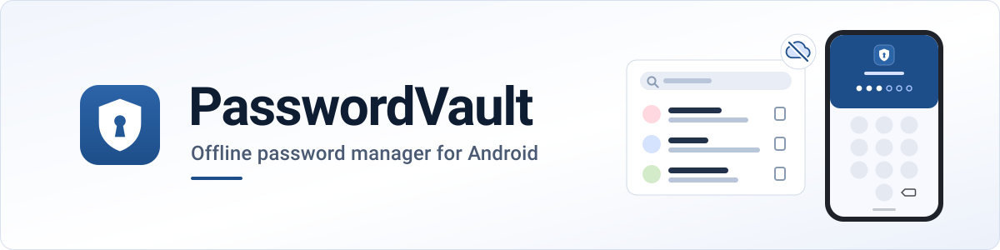
</picture>

### Your passwords on your phone, and nowhere else.

<p>
<a href="https://github.com/DilshodbekMX/PasswordVault/actions/workflows/checks.yml"></a>


</p>
 
[Why PasswordVault](#why) ·
[Features](#features) ·
[Get started](#get-started) ·
[Screenshots](#screenshots) ·
[Backups](#backups) ·
[Security](#security) ·
[Troubleshooting](#troubleshooting) ·
[Development](#development)

<br>

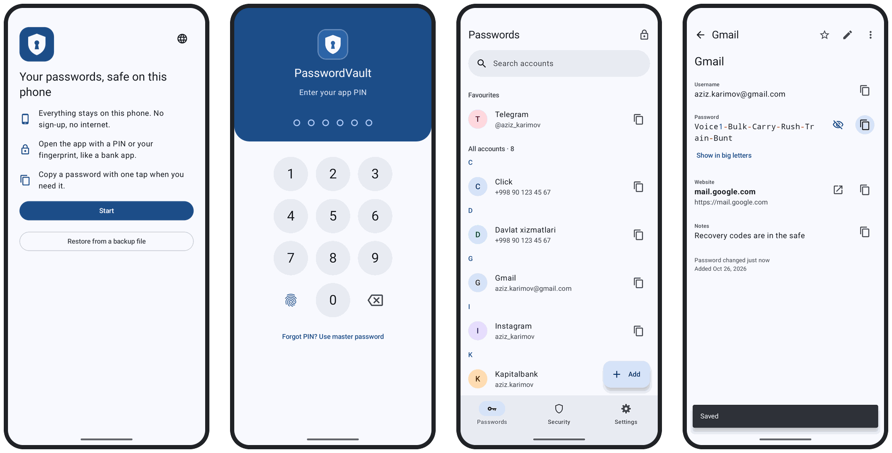

<sub>Welcome, the PIN pad, your accounts, and one account with its password shown. A test build on an Android 17 emulator with made-up accounts; the status bar and the test build's red warning line are hidden.</sub>

</div>

<br>

<a id="why"></a>

## 💡 Why PasswordVault

<table>
<tr>
<td width="33%" valign="top">

### 📵 Nothing leaves the phone
No account, no server, no sync. The app **has no internet permission**, and its build fails if a
library ever adds one. Backups are files that you save where you choose.

</td>
<td width="33%" valign="top">

### 🏦 It opens like a bank app
A **6-digit PIN** or **your fingerprint**, with keys kept in the phone's secure hardware. Under
them, a master password that nobody can reset, stretched with **Argon2id**; the passwords are
sealed with **AES-256-GCM**.

</td>
<td width="33%" valign="top">

### 🧪 Built to be checked
**3,197 JVM tests and 629 device tests**, 17 build checks, and 17 lock checks spread over
Android 7, 9 and 17 emulators. The backup format is documented, and a script opens a backup
without the app.

</td>
</tr>
</table>

PasswordVault is for one person who wants their passwords on their own phone, in their own
language: **English, Oʻzbekcha, Ўзбекча or Русский**.

> [!IMPORTANT]
> PasswordVault 1.0 is new. It has been tested only on emulators (Android 7, 9 and 17), not yet on
> a real phone. Emulators keep keys in software, which a release build refuses, so PIN and
> fingerprint unlock have run only in test builds. Its code has not had an independent security
> audit. Keep a backup, and read [what it cannot protect you from](#security).

<br>

<a id="features"></a>

## ✨ What it is like to use

<table>
<tr>
<td width="50%" valign="top">
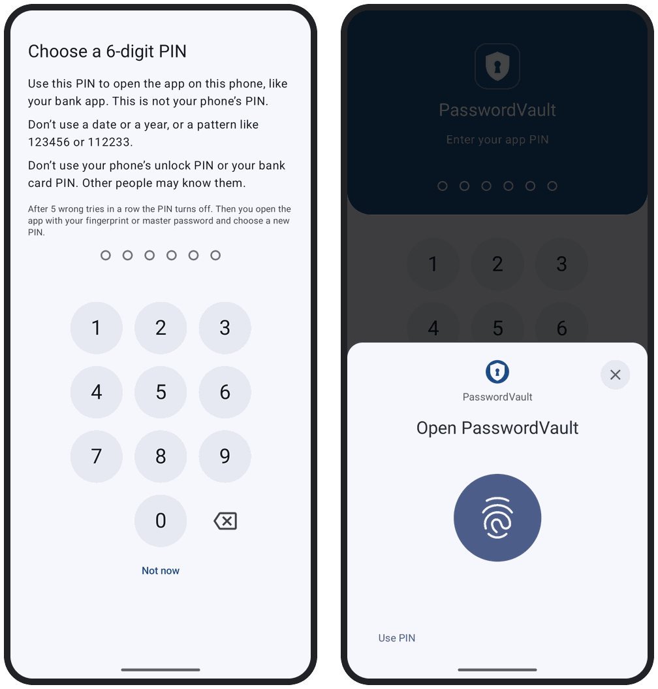
</td>
<td valign="top">

### 🔐 A lock like your bank app's
Choose a **6-digit PIN** for this app, not your phone's PIN. It refuses PINs that look like a date
or a year, repeat digits or follow a pattern (`112233`), or are a sequence or a shape on the keypad
(`123456`, `147258`). Add your fingerprint if you like. After **5 wrong PINs in a row** the PIN
turns off, and only your fingerprint or your master password opens the app. It locks when the
screen turns off, after 5 minutes without a touch, and when you leave it: after 30 seconds, or, if
you choose, at once, after 1 minute or after 5 minutes.

</td>
</tr>
<tr>
<td valign="top">

### 🎲 Strong passwords you don't have to remember
The generator makes **random characters** (4 to 64 of them: capitals, small letters, digits and
symbols, leaving out the look-alikes `I l 1 O 0` unless you turn that off) or **words** (4 to 12
words from EFF's short list of 1,295 words, joined by a hyphen, dot, underscore or space, with
capitals and a number unless you turn them off). The strength meter is zxcvbn with lists added, so
it also knows common Uzbek and Russian words, names and places, in Latin or Cyrillic letters.

</td>
<td width="50%" valign="top">
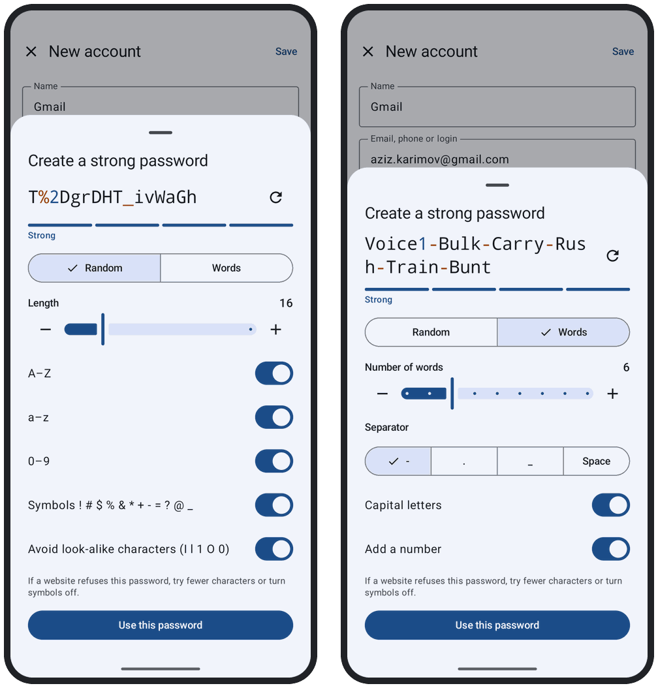
</td>
</tr>
<tr>
<td width="50%" valign="top">
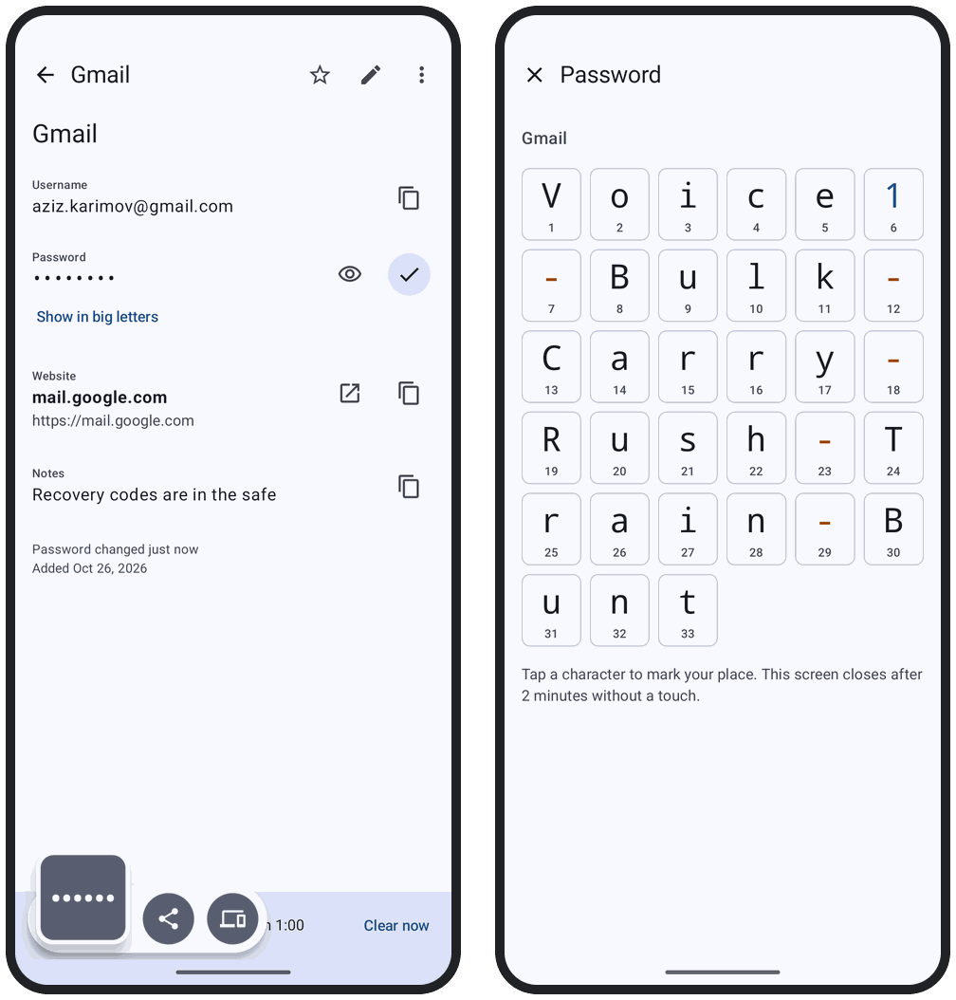
</td>
<td valign="top">

### 📋 Copy, paste, and the clipboard is cleared
One tap copies a password. A row at the bottom counts down until the clipboard is cleared (after
1 minute, or 30 seconds, 2 or 5 minutes if you choose), with **Clear now**. The copy is marked as
sensitive, so on Android 13 and later the system's preview shows dots. Your keyboard's own
clipboard history may keep a copy, and after a force-stop, or with battery use set to
"Restricted", the password stays on the clipboard until you open the app again. **Show in big
letters** puts a password on the screen in large, numbered characters, for reading it aloud or
typing it on another device.

</td>
</tr>
<tr>
<td valign="top">

### 🛡️ Find reused and easy-to-guess passwords
The **Security** tab shows which accounts share a password, which passwords are easy to guess, and
any account whose password is also your master password. A guided change takes you through each
website in five steps: sign in, find "Change password", create the new password, paste the old and
new ones into the website, and say whether the website accepted it. Until you answer, the old
password is kept, and **No, put back the old password** brings it back.

</td>
<td width="50%" valign="top">
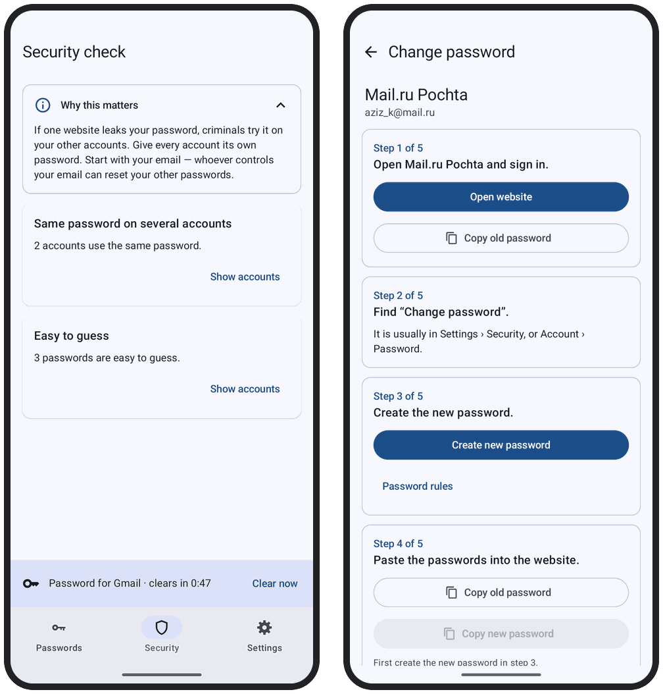
</td>
</tr>
<tr>
<td width="50%" valign="top">
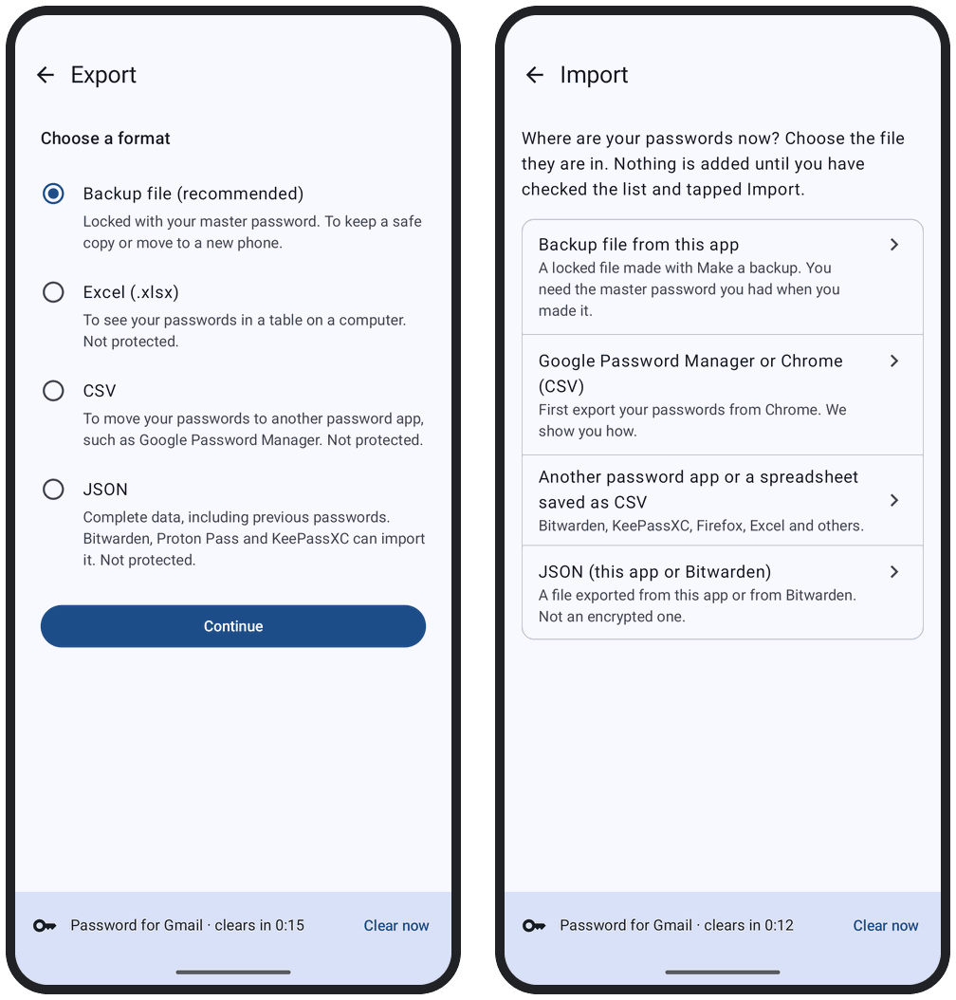
</td>
<td valign="top">

### 📦 Your data, in files you control
A **backup** is an encrypted file that opens only with your master password. Save it to Google
Drive or anywhere else Android's file picker reaches, or send it to another app, and keep a copy
off the phone, for example on a computer. **Export** to Excel, CSV or JSON, and **import** from
Google Password Manager, Chrome, Bitwarden, KeePassXC, Firefox or a spreadsheet saved as CSV.

</td>
</tr>
</table>

<br>

<a id="offline"></a>

## ⚖️ Offline, honestly

Keeping everything on one phone is a trade. This is what it gives and what it costs.

**What offline gives you**

| | |
|---|---|
| **Nothing to breach** | No account and no server. Your passwords exist in an encrypted file on your phone and in the backups you make |
| **No way online** | The app does not ask for the internet permission. A build check fails the build if a library adds it, and a check of the finished APKs looks again |
| **No tracking** | No analytics, crash reporting, advertising or network libraries |
| **It works anywhere** | In airplane mode, abroad, without mobile data |
| **Your data stays readable** | The backup format is [documented](docs/format.md), and [`tools/pvault_decrypt.py`](tools/pvault_decrypt.py) opens a backup on a computer, without the phone |

**What PasswordVault does not have**

| | |
|---|---|
| **Sync between devices** | One phone. A backup file moves your passwords to a new one |
| **Autofill** | You copy and paste; the clipboard is cleared for you |
| **Breach alerts** | Without the internet it cannot tell you that a website leaked your password |
| **Account recovery** | Nobody can reset your master password for you. While your PIN or fingerprint still opens the app, you can choose a new one, which starts working after 24 hours. Write it on paper; the app asks you to type it now and then so you keep it |
| **Automatic cloud backup** | You save backups yourself. The app reminds you when your newest passwords are not in one |
| **iPhone, computer or browser versions** | Android only |

<br>

<a id="get-started"></a>

## 🚀 Get started

PasswordVault is not in Google Play or F-Droid, and there is no ready-made APK yet: you build it
yourself.

### What you need

| Requirement | Why |
|---|---|
| **Linux** | The build is made and checked on Ubuntu. [`gradle/verification-metadata.xml`](gradle/verification-metadata.xml) holds the checksums of Linux's build tools (`aapt2`) only, so on macOS or Windows the build stops at dependency verification |
| **JDK 25** | Gradle's daemon runs on Java 25 ([`gradle/gradle-daemon-jvm.properties`](gradle/gradle-daemon-jvm.properties)) |
| **Android SDK** with platform 37 (Android 17) | Compiles the app. Set `ANDROID_HOME`, or open the project once in Android Studio |
| **A phone with Android 7.0 or newer** (ARM), and a USB cable that carries data | To install it with `adb` |
| **8 GB of memory or more** | Gradle's daemon is given a 4 GB heap, and the Kotlin compiler's own process can take as much again |

### Try it: a test build

```bash
git clone https://github.com/DilshodbekMX/PasswordVault.git
cd PasswordVault
./gradlew :app:assembleDebug                                    # → app/build/outputs/apk/debug/app-debug.apk
adb install -r app/build/outputs/apk/debug/app-debug.apk
```

A test build can be debugged over USB, accepts keys that are not in secure hardware and allows
screenshots. Its lock screen says **TEST BUILD: PIN keys are not protected**, and it is not for
your real passwords. Try it on an emulator or a spare phone: your release build will not install
over it (`INSTALL_FAILED_UPDATE_INCOMPATIBLE`) until it is uninstalled, which deletes everything in
it.

### Use it: a release build signed with your own key

```bash
# once: make your release key in a folder of its own, outside the project (it asks for a password twice)
mkdir -p ~/passwordvault-key
keytool -genkeypair -storetype PKCS12 -keystore ~/passwordvault-key/passwordvault-release.jks \
  -alias passwordvault -keyalg RSA -keysize 4096 -validity 10000 -dname "CN=PasswordVault release key"

# keystore.properties in the project folder (git ignores it):
#   storeFile=/home/YOU/passwordvault-key/passwordvault-release.jks
#   storePassword=…
#   keyAlias=passwordvault
#   keyPassword=…        (the same password again)

./gradlew :app:assembleRelease                                  # → app/build/outputs/apk/release/app-release.apk
adb install -r app/build/outputs/apk/release/app-release.apk
```

Android Studio's **Build › Generate Signed App Bundle or APK…** builds and signs it too: choose
**APK**, the same key file, the **release** variant, and a destination folder outside the project.

> [!WARNING]
> **Keep the release key and its password safe, in two copies.** Android installs an update only
> when it is signed with the same key, and nobody can make that key again.
>
> **Never uninstall PasswordVault to make an update install.** Uninstalling deletes every password
> on the phone. A test build (the one above, or Android Studio's **Run**) and your release build
> have the same app ID but different keys, so Android never installs one over the other, and only
> one of them can be on the phone. If Android Studio offers to uninstall the app first, answer
> **Cancel**. To replace a test build that holds passwords you need, move them with a backup file
> first (see [Troubleshooting](#troubleshooting)).

[`docs/release/`](docs/release/README.md) goes through all of this step by step: the checks to run
on the APK before installing it, a printable form of checks that only a real phone can answer, and
how to update. It was written for the owner's computer: change the paths to yours, and set
`PV_JAVA_HOME` and `PV_ANDROID_HOME` for `tools/gradle.sh`. Where a page says to stop and ask for
help, find out what went wrong before you go on.

<br>

<a id="screenshots"></a>

## 📸 A closer look

<table>
<tr>
<td width="33%" valign="top">
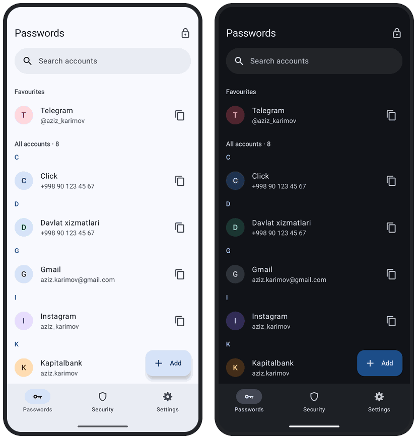
<p align="center"><b>Bank blue</b><br><sub>The default, light and dark</sub></p>
</td>
<td width="33%" valign="top">
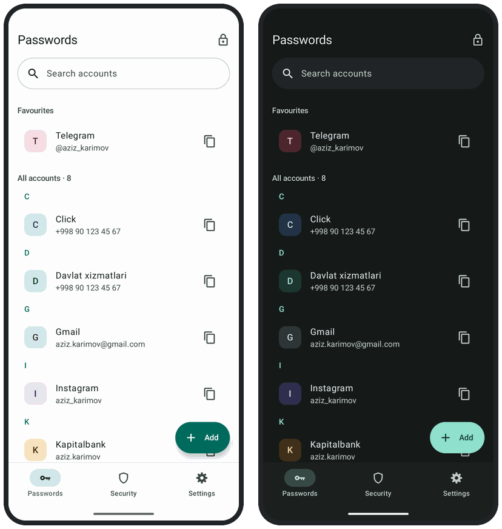
<p align="center"><b>Emerald</b><br><sub>Light and dark</sub></p>
</td>
<td width="33%" valign="top">
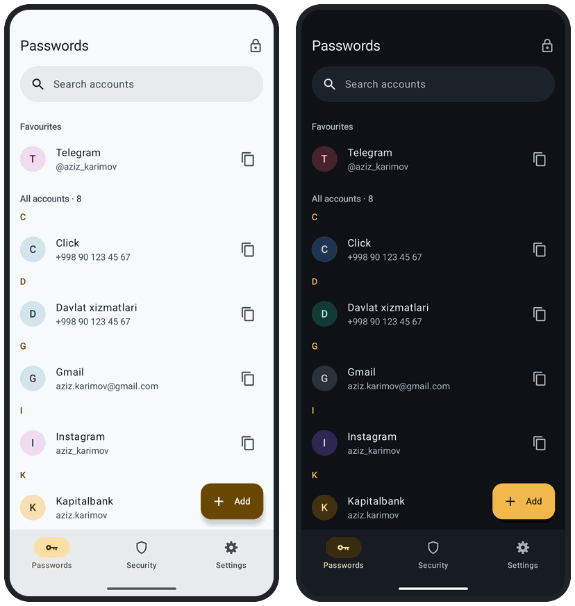
<p align="center"><b>Night vault</b><br><sub>Light and dark</sub></p>
</td>
</tr>
</table>

Settings › Appearance offers these three styles, and **Phone's colours** (your wallpaper's
colours) on Android 12 and later; each follows the phone's light or dark mode, or stays light or
dark.

<table>
<tr>
<td width="25%" valign="top">
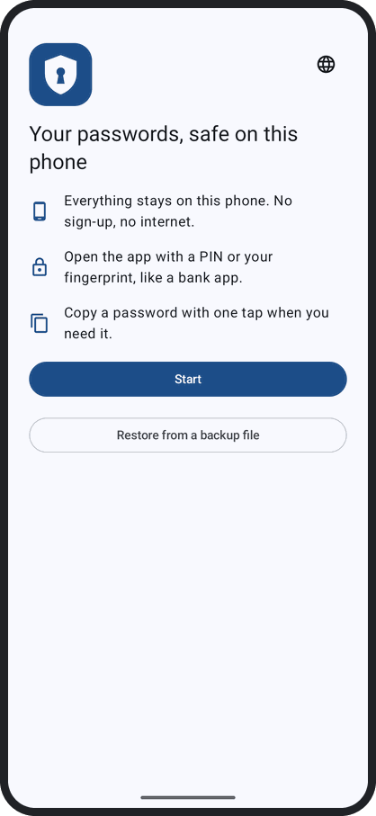
<p align="center"><b>English</b></p>
</td>
<td width="25%" valign="top">
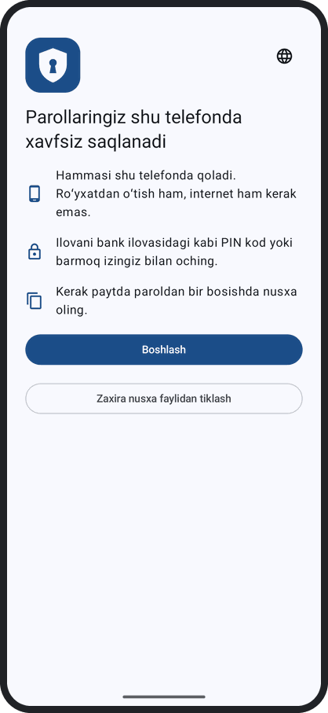
<p align="center"><b>Oʻzbekcha</b></p>
</td>
<td width="25%" valign="top">
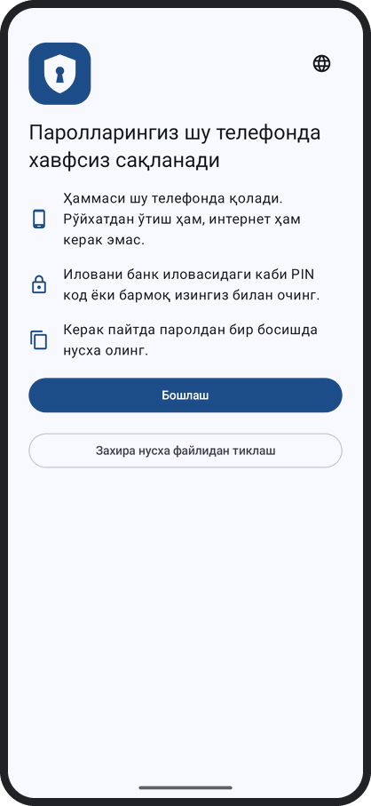
<p align="center"><b>Ўзбекча</b></p>
</td>
<td width="25%" valign="top">
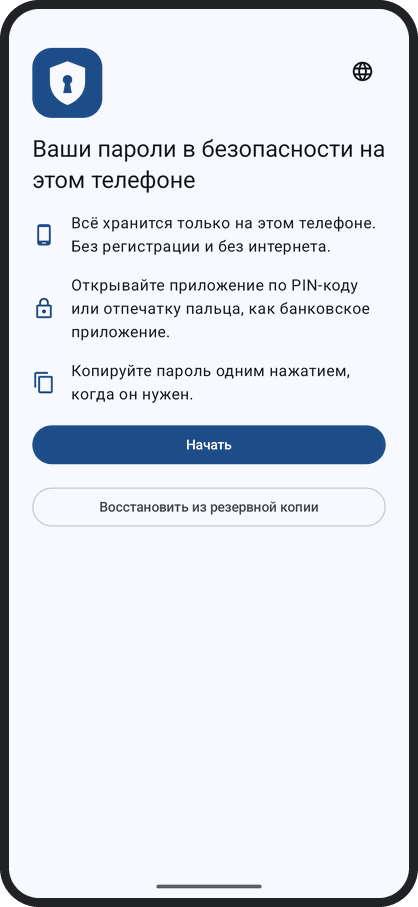
<p align="center"><b>Русский</b></p>
</td>
</tr>
</table>

The app has its own language choice (🌐 on the first screen, and in Settings), so Uzbek in Cyrillic
letters works even though Android itself is not translated into Cyrillic Uzbek. Search compares
Latin and Cyrillic letters by the Uzbek rules, so "тошкент" finds "Toshkent", and it ignores which
apostrophe you type. When nothing is found, it tries the same keys on the other keyboard layout.

<br>

<a id="backups"></a>

## 💾 Backups, export and import

| Format | What it holds | Protected | Made for |
|---|---|:---:|---|
| **Backup file** `PasswordVault-backup-YYYY-MM-DD.pvault` | All your accounts, with notes, extra fields, previous passwords and Recently deleted (not the app's settings, PIN or fingerprint) | ✅ opens only with the master password you had when you made it | A safe copy, and moving to a new phone |
| **Excel** `.xlsx` | Your accounts, as a table | ❌ | Reading your passwords in a table on a computer |
| **CSV** | Name, website, username, password, and a note that ends with the extra fields, hidden ones too; no previous passwords or favourites | ❌ | Google Password Manager and other password apps |
| **JSON** | Every account outside Recently deleted, previous passwords included | ❌ | Bitwarden, Proton Pass and KeePassXC can import it |

**The app never uploads anything.** It saves through Android's file picker, where Google Drive
appears when its app is on the phone, or hands the encrypted file to another app with **Send to
another app…**. Unless you turn them off, reminders tell you when your newest passwords are not in a
backup yet: a day after your first account, and later once you have changed something and your
newest backup is a week old.

> [!CAUTION]
> Excel, CSV and JSON files are **not encrypted**: anyone who gets one can read every password in
> it. Keep them only where you control them, and delete them when you are done.

**Import** reads a backup from this app (its accounts are added, nothing is replaced), a CSV from
Google Password Manager or Chrome (the app shows how to make one), a CSV from another app or a
spreadsheet (Bitwarden, KeePassXC, Firefox, Excel and others; when the app does not recognise the
columns, you match them yourself), and JSON from this app or Bitwarden. Before anything is added, a
preview shows what will be imported. A file may have up to 10 MiB and 10,000 rows.

### A new phone

Install PasswordVault, tap **Restore from a backup file**, choose your newest backup and type the
master password you had when you made it, then choose a PIN for the new phone. Android's own
transfer ("Copy apps and data") does not bring your passwords: Android's backup is turned off for
this app on purpose. Phone makers' copy tools have not been tried with it, so don't count on them
either. A restore never deletes the passwords already on the phone: they are put aside, locked,
under **Settings › Old passwords**.

### Opening a backup without the app

If the phone and the app are gone, a computer with Python 3.9 or newer opens a backup:

```bash
python3 -m pip install --upgrade cryptography      # version 44 or newer: Argon2id
python3 tools/pvault_decrypt.py --check            # its last line says "Everything is ready"
python3 tools/pvault_decrypt.py PasswordVault-backup-2026-10-07.pvault passwords.csv
```

On Windows, type `py` instead of `python3`. If pip refuses because the system's Python is
"externally managed" (some Linux systems), the script says how to make a small environment for it.

The script asks for the master password you had when you made the backup, says how many accounts it
holds, and writes nothing until you type `yes`. The new file's name must end in `.csv` or `.json`;
other password managers can import either. Accounts in Recently deleted are not written. The new
file is not protected, so delete it when you are done. [docs/format.md](docs/format.md) explains
all this for everyone first, then describes the file format for programmers.

<br>

<a id="security"></a>

## 🛡️ Security

<details open>
<summary><b>What protects you</b></summary>
<br>

- **Encryption.** Your accounts are in one file, encrypted with AES-256-GCM under a vault key of
  32 random bytes. The file's header, with the Argon2id settings and the wrapped vault key, is
  authenticated together with your accounts, so a file whose header was changed does not open.
  Your master password, stretched with Argon2id version 1.3 (64 MiB of memory, 3 passes, 4 lanes),
  opens that file on any phone. Each backup has a key of its own and opens with the master password
  you had when you made it.
- **One form of the master password.** Before it is stretched, the master password is put in one
  standard form, the same on every phone: the different apostrophes that keyboards type (ʻ ’ ' and
  others) count as one, several spaces in a row count as one, and spaces at the start or end are
  dropped. Capital letters still count. Test vectors fix this rule, because changing it would lock
  people out.
- **Keys in secure hardware.** The PIN and the fingerprint each unlock a copy of the vault key
  that exists only on this phone. The PIN becomes a key through an HMAC under an Android Keystore
  key that never leaves the phone's secure hardware, so a copy of the app's files cannot test even
  one PIN. A release build refuses Keystore keys that are not in secure hardware: on such a phone
  the app opens with the master password only. From Android 15 the PIN key works only while the
  phone is unlocked.
- **Fingerprint.** Only strong (Class 3) biometrics: a fingerprint, or a face unlock that Android
  rates Class 3. When the phone's fingerprints or screen lock change, fingerprint unlock turns
  itself off until you turn it on again.
- **Limits on guessing.** 5 wrong PINs in a row turn the PIN off, and so do 10 wrong PINs over a
  longer time, counted until you next type your master password. After 5 wrong master passwords,
  each further try waits 30 seconds. Argon2id is never made cheaper to fit a phone short of memory:
  the app says that there is not enough memory instead, and that never counts as a wrong try.
- **A new master password waits.** Someone who knows your PIN (or, when no PIN is set, whose
  fingerprint opens the app) can choose a new master password, but it starts working only after
  24 hours with the phone switched on. Until then the app tells you about it each time you open it.
  It sends no notification: if you don't open the app in that time, nothing warns you, and then
  that person can make a backup or an export of your passwords.
- **Nothing leaves.** No internet permission. Android's cloud backup and phone-to-phone copying
  take nothing from the app (`allowBackup="false"`, and the transfer rules exclude everything).
- **The screen.** Release builds block screenshots, screen recording and the app's picture in the
  Recents screen. Taps that come through another app's window are ignored, and from Android 12
  other apps' floating windows are hidden while the app is open. A password shown as dots gives
  other apps only dots, accessibility services included, and from Android 14 the app's windows are
  hidden from services that are not accessibility tools.
- **The clipboard.** A copied password is marked as sensitive, so Android 13 and later hide it in
  the clipboard preview, and it is removed after the time you chose (30 seconds to 5 minutes).
  After a force-stop, or with battery use set to "Restricted", it stays until you open the app
  again, and a keyboard that keeps its own list of copied text may keep a copy.
- **Damaged files.** The app deletes an old copy of your vault only while at least five newer
  copies are known to open. If the newest copy is damaged, it opens the newest one that is not, and
  tells you so.
- **The build.** Every dependency is locked to a version and checked against its SHA-256 sum
  ([`gradle/verification-metadata.xml`](gradle/verification-metadata.xml)). 17 build checks catch,
  for example, a new permission, an exported component, or test code in a release APK: ten are part
  of the build itself, six are unit tests and one is a device test.

</details>

<details>
<summary><b>What it cannot protect you from</b></summary>
<br>

- **A hacked or "rooted" phone.** There, someone can try every PIN in a few hours, and the right
  one opens your passwords. Your master password still protects your backups, so make it strong and
  never use it anywhere else.
- **A harmful keyboard app, or an app you allowed to control the phone** (accessibility). A
  keyboard sees everything you type with it, your master password included. An app that controls
  the phone can read a password while you show it on the screen: any such app on Android 13 and
  older, and from Android 14 one that is an accessibility tool, as TalkBack is.
- **Anyone whose fingerprint (or Class 3 face) is saved in the phone,** once you turn fingerprint
  unlock on. They can open the app.
- **Someone with your unlocked phone.** They can delete the app, and your passwords with it. Only
  a backup kept outside the phone survives that.
- **A weak master password.** Anyone who gets a backup file can try master passwords on a
  computer, with no limit on tries. Use the six words the app suggests, or something as hard to
  guess.
- **Unencrypted exports.** An Excel, CSV or JSON file is readable by whoever has it.

</details>

The full design is in [docs/design/](docs/design/): the lock (PIN, fingerprint, master password)
in [lock.md](docs/design/lock.md), the app's structure and file format in
[architecture.md](docs/design/architecture.md), and the import and export formats in
[formats.md](docs/design/formats.md). The research behind them is in [docs/research/](docs/research/).
These documents also record plans, history and options that were turned down, and a few of their
lines are out of date; where they and the code differ, the code is right.

<br>

<a id="troubleshooting"></a>

## 🩺 Troubleshooting

Help is also in the app once it is open: **Settings › Help**. While the app is locked, use the
lock-screen buttons named below.

<details>
<summary><b>Opening the app</b></summary>
<br>

| Symptom | What to do |
|---|---|
| You forgot your PIN | Tap **Forgot PIN? Use master password**, type your master password, and choose a new PIN |
| "Your PIN was entered wrong too many times, so it was turned off." | Nothing was deleted. Type your master password, then choose a new PIN |
| "Fingerprint unlock was turned off because this phone's fingerprints or screen lock changed." | Use your PIN, or your master password when the app asks for it. Then turn fingerprint unlock on again when the app offers it, or in **Settings › App lock › Fingerprint unlock**; it asks for your master password |
| You forgot your master password | If your PIN or fingerprint still opens the app: **Settings › App lock › Change master password › I don't remember it**. The new one starts working after 24 hours with the phone switched on; the count stops while the phone is off, so open the app in the morning and in the evening. Then make a new backup: old backups still open only with the old master password. Otherwise, try the words on your paper, or on the lock screen tap **Forgot master password?** › **Restore from a backup file** and use a backup whose master password you remember |
| "That's not the right master password." | Check the keyboard's language (Latin or Cyrillic letters) and capital letters |
| "Your phone doesn't have enough free memory to open your passwords." | Close other apps or restart the phone. This is never counted as a wrong try |
| "This phone can't keep a PIN or fingerprint key in protected hardware…" | The phone has no secure key storage, so the app opens with the master password only |

</details>

<details>
<summary><b>Backups and new phones</b></summary>
<br>

| Symptom | What to do |
|---|---|
| "Welcome back" | Your passwords are on this phone, but no PIN or fingerprint is set up for them here yet. Type your master password once, then choose a PIN for this phone |
| "This password does not open this backup." | Type the master password you had when you made that backup |
| "This backup was made by a newer version of the app." | Install the newest version of PasswordVault |
| The passwords did not come with "Copy apps and data" | That is on purpose. Make a backup on the old phone and restore it on the new one |

</details>

<details>
<summary><b>Installing and updating</b></summary>
<br>

| Message | What to do |
|---|---|
| `INSTALL_FAILED_UPDATE_INCOMPATIBLE` … signatures do not match | The phone has the app signed with another key, for example a test build. If it holds nothing you need, uninstall it. If it does, make a backup in it first (**Settings › Make a backup**) and copy the backup off the phone; then uninstall it, install the new APK and tap **Restore from a backup file** |
| `INSTALL_FAILED_VERSION_DOWNGRADE` | The phone has a newer version. Install the newest APK |
| `INSTALL_FAILED_USER_RESTRICTED` | Xiaomi, Redmi or POCO: turn on **Install via USB** in Developer options, then tap **Install** on the phone when it asks |
| `INSTALL_FAILED_NO_MATCHING_ABIS` | The release APK has ARM code only. A device that cannot run ARM code refuses it, such as the Android 7 and 9 x86_64 emulators (the Android 17 Google Play emulator runs it). Install it on a phone, or use the test build there |
| The build wrote `app-release-unsigned.apk` | `keystore.properties` is missing from the project folder, so the APK is not signed and Android will not install it. Write the file as in [Get started](#get-started), then build again |
| Android Studio offers to uninstall the app | Answer **Cancel**: uninstalling deletes every password on the phone |

</details>

<br>

<a id="development"></a>

## 🧑‍💻 Development

```bash
./gradlew :app:assembleDebug                                # a test build
./gradlew :core:testDebugUnitTest :app:testDebugUnitTest    # 3,197 JVM tests (2,644 test methods)
./gradlew :core:lintDebug :app:lintDebug                    # lint; :core's lint checks every call against API 24
tools/check.sh all                                          # unit tests, lint, three APKs with the build checks, the offline checks
```

`tools/check.sh` runs Gradle through [`tools/gradle.sh`](tools/gradle.sh), which needs bash and
`flock` and defaults to the owner's machine: point `PV_JAVA_HOME` at a JDK 25 and `PV_ANDROID_HOME`
at your Android SDK. GitHub Actions runs `tools/check.sh all` on every push to `main` and every pull
request ([`.github/workflows/checks.yml`](.github/workflows/checks.yml)); the device tests are not
part of it.

The device tests run with `ANDROID_SERIAL=SERIAL ./gradlew :app:connectedDebugAndroidTest` on an
emulator or a spare phone, never on the phone that holds your passwords. Gradle reports success even
on a device where it could not install the app, so check the reports with
`tools/emu/adb.sh --connected-results app/build/outputs/androidTest-results/connected/debug SERIAL…`.
On the private emulators of `tools/emu/`, `tools/emu/adb.sh --connected SERIAL…` does both and names
the commit it checked.

| | debug | staging | release | backupCheck |
|---|---|---|---|---|
| **For** | daily work and emulator checks | emulator checks of the optimised code | what you install | one lock check (Android backup allowed) |
| **Signed with** | the debug key | the debug key | your key from `keystore.properties` | the debug key |
| **R8** | off | on | on | off |
| **Screenshots blocked** | no | yes | yes | no |
| **Keys outside secure hardware** | allowed (TEST BUILD) | allowed (TEST BUILD) | refused | allowed (TEST BUILD) |

<details>
<summary><b>The build checks</b></summary>
<br>

Ten run with every `assemble` task, six are JVM tests over the sources, and R-3 is a device test.
The offline checks are part of `tools/check.sh`.

| Check | What it catches |
|---|---|
| R-1 | the `INTERNET` permission in the merged manifest |
| R-2 | software keys allowed in release, or the debug command receiver in the release APK |
| R-3 | the lock's files outside the folder Android never backs up (device test) |
| R-4 | the context-based biometric API, which the lock's design leaves out |
| R-5 | the fingerprint dialog activity exported |
| R-6 | logging anywhere in `:core`, or in the app's code outside the debug and staging source sets |
| R-7 | `HIDE_OVERLAY_WINDOWS` missing |
| R-8 | native libraries for other ABIs than the variant's |
| R-9 | a permission outside the allowed list, or a component exported beyond the expected ones |
| R-10 | an Android import in `:core` or `:testing` |
| R-11 | banned APIs, such as `Toast`, `AtomicFile`, `java.time` or `java.util.Base64` |
| R-12 | build output tracked by git |
| R-13 | a text field, dialog or sheet that bypasses the app's own wrappers, or a hard-coded UI string |
| R-14 | a package name other than the app ID |
| R-15 | a test-only master-password proof used outside the places allowed |
| R-16 | R8 removing the fingerprint callbacks that Android 7 and 8 need |
| R-17 | debug or fake classes in the release APK, or test classes in any APK |
| Offline (`tools/check.sh`) | the internet permission in the debug, staging or release APK (`aapt2`), or networking classes in the sources |

</details>

<details>
<summary><b>Emulator checks</b></summary>
<br>

[`tools/emu/`](tools/emu/README.md) runs every device check on private emulators of Android 7.0
(API 24), 9 (API 28) and 17 (API 37), started read-only from a base under `/home/asus/pvlab` (set
`PV_LAB` for yours) that `tools/emu/boot.sh --provision API` makes once for each Android version.
It holds the 17 lock checks (`lock/E1.sh` … `E17.sh`), the integration checks of each stage of the
build (`checks/`), and suites for the clipboard, windows and input, languages, layout with long
texts, auto-lock, setup and the guided password change. Each run's log names the commit it checked.

</details>

<details>
<summary><b>Dependencies</b></summary>
<br>

Every configuration is locked (`*/gradle.lockfile`, `buildscript-gradle.lockfile`,
`settings-gradle.lockfile`), and every dependency that Gradle downloads is checked against its
SHA-256 sum in [`gradle/verification-metadata.xml`](gradle/verification-metadata.xml) (the `-javadoc`
and `-sources` jars that Android Studio fetches are trusted without one). After changing a version,
regenerate both in the same commit with the two commands in the comment in
[`build.gradle.kts`](build.gradle.kts). Run them in a fresh clone with an empty Gradle home, as a CI
server starts: Gradle does not record the files its own cache already answers. Then put back by hand
the comment that Gradle's rewrite drops from the metadata's `<configuration>` part.

`androidx.biometric` is pinned to 1.4.0-alpha07 on purpose: with the stable 1.1.0, fingerprint
unlock does not work on Android 7 and 8. Moving to another version means running the lock checks
E6 to E9 and build check R-16 again.

</details>

<br>

<a id="how-it-works"></a>

## 🏗️ How it works

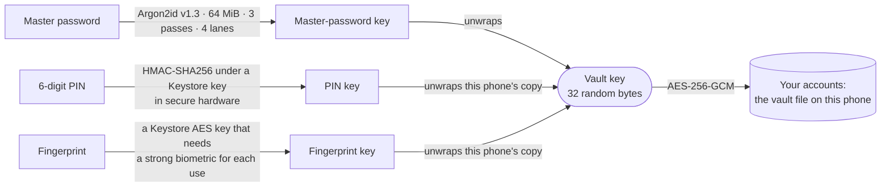

- **One root, two shortcuts.** The master password alone opens the vault file, on any phone, and
  every backup made while it was your master password. The PIN and the fingerprint each unlock a
  copy of the vault key that exists only on this phone, bound to a Keystore key. Losing a shortcut
  never loses data.
- **Each backup has a key of its own.** A backup is sealed under a new random key, which only the
  master password you had when you made it unwraps. The PIN and the fingerprint cannot open a
  backup, even on this phone.
- **Every PIN guess goes through the phone's secure hardware.** The HMAC key never leaves it, so
  a copy of the app's files is useless for guessing the PIN.
- **The core has no Android in it.** `:core` holds the cryptography, the lock's rules and counters,
  the vault file, search, import and export as plain Kotlin (a build check forbids Android imports
  there), so its 2,079 tests run on the JVM. `:app` adds the screens, the Keystore, the clipboard
  and files.

<details>
<summary><b>Project layout</b></summary>
<br>

```
PasswordVault/
├── app/          the Android app: screens (Jetpack Compose), the lock, Keystore keys, clipboard, files
├── core/         the vault's logic, without Android: cryptography, the lock's rules, the vault file, search, import and export
├── testing/      fakes of core's interfaces and the source scanner of the build checks (tests only)
├── tools/        check.sh, gradle.sh, the emulator checks (emu/), export validators (validate/), pvault_decrypt.py
├── prototypes/   the password-protected Excel export, kept for version 1.1
├── docs/         design/, research/, release/, format.md (the backup file), lab reports, screen pictures
└── .github/      the GitHub Actions workflow that runs tools/check.sh
```

</details>

<br>

<a id="roadmap"></a>

## 🧭 Not in PasswordVault (yet)

Nothing here is promised. It is simply what version 1.0 does not do.

| Missing | Where that leaves you |
|---|---|
| Autofill and passkeys | Copy and paste; the clipboard is cleared for you |
| Sync between phones | A backup file moves your passwords |
| One-time codes (TOTP) | An imported TOTP secret (from Bitwarden, or from a CSV column such as `totp` or `otp`) is kept as a hidden extra field "TOTP"; the app shows no codes |
| Attachments | Notes and extra fields hold text |
| Folders and tags | Favourites and search; an imported folder becomes an extra field "Folder" |
| A password-protected Excel export | Prototyped for version 1.1 in [`prototypes/formats/`](prototypes/formats/); the backup file is encrypted today |
| Importing Excel or KeePass (`.kdbx`) files | Save the sheet as CSV, or export CSV from KeePassXC |
| Notifications | Messages inside the app |
| A store release | [Build it yourself](#get-started) |

<br>

<a id="licence"></a>

## 📄 Licence

PasswordVault is free software under the **GNU General Public License v3.0** ([LICENSE](LICENSE)).
You may use, study, change and share it. If you share it, changed or not, you must share it under
the same licence, and with an APK you must also offer its source.

The libraries, word lists and test material from others, with their licences, are listed in
[NOTICE.md](NOTICE.md).

<br>

<div align="center">

### Ready?

```bash
git clone https://github.com/DilshodbekMX/PasswordVault.git && cd PasswordVault && ./gradlew :app:assembleDebug
```

[Release steps](docs/release/README.md) · [Backup format](docs/format.md) · [GPL-3.0](LICENSE) · Third-party notices in [NOTICE.md](NOTICE.md)

<sub>Built with Kotlin, Jetpack Compose, Bouncy Castle, Argon2 and the Android Keystore</sub>

</div>
