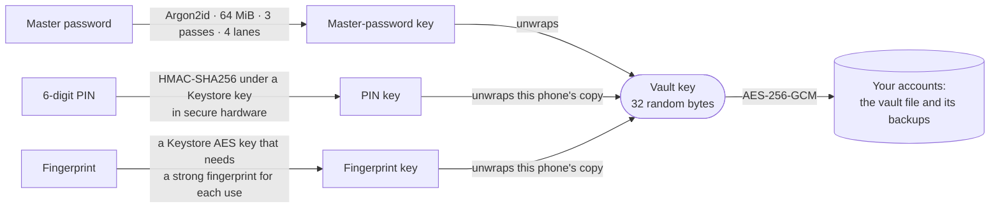

<div align="center">

<picture>
  <source media="(prefers-color-scheme: dark)" srcset="docs/images/banner-dark.svg">
  
</picture>

### Your passwords on your phone, and nowhere else.

<p>


</p>

[Why PasswordVault](#why) ·
[Features](#features) ·
[Get started](#get-started) ·
[Screenshots](#screenshots) ·
[Backups](#backups) ·
[Security](#security) ·
[Troubleshooting](#troubleshooting) ·
[Development](#development)

<br>


<sub>Welcome, the PIN pad, your accounts, and one account with its password shown. Android 17 emulator, made-up accounts.</sub>

</div>

<br>

<a id="why"></a>

## 💡 Why PasswordVault

<table>
<tr>
<td width="33%" valign="top">

### 📵 Nothing leaves the phone
No account, no server, no sync. The app **has no internet permission**, and its build fails if a
library ever adds one. Backups are files that you save where you choose.

</td>
<td width="33%" valign="top">

### 🏦 It opens like a bank app
A **6-digit PIN** or **your fingerprint**, with keys kept in the phone's secure hardware. Under
them, a master password that nobody can reset, stretched with **Argon2id**; the passwords are
sealed with **AES-256-GCM**.

</td>
<td width="33%" valign="top">

### 🧪 Built to be checked
**2,644 unit tests and 629 device tests**, 17 checks that fail the build, and 17 lock checks run
on Android 7, 9 and 17 emulators. The backup format is documented, and a script opens a backup
without the app.

</td>
</tr>
</table>

PasswordVault is for one person who wants their passwords on their own phone, in their own
language: **English, Oʻzbekcha, Ўзбекча or Русский**.

> [!IMPORTANT]
> PasswordVault 1.0 is new. It has been tested on emulators (Android 7, 9 and 17) but not yet on a
> range of real phones, and it has not had an independent security audit. Keep a backup, and read
> [what it cannot protect you from](#security).

<br>

<a id="features"></a>

## ✨ What it is like to use

<table>
<tr>
<td width="50%" valign="top">

</td>
<td valign="top">

### 🔐 A lock like your bank app's
Choose a **6-digit PIN** for this app, not your phone's PIN. It refuses PINs that look like a
date or a year, repeat digits or follow a pattern like `123456`. Add your fingerprint if you like. After **5 wrong PINs in a row** the
PIN turns off, and only your fingerprint or your master password opens the app. It locks when the
screen turns off, after 5 minutes without a touch, and when you leave it: at once, or after 30
seconds, 1 minute or 5 minutes.

</td>
</tr>
<tr>
<td valign="top">

### 🎲 Strong passwords you don't have to remember
The generator makes **random characters** (4 to 64 of them: capitals, small letters, digits and
symbols, without look-alikes such as `I l 1 O 0` if you want) or **words** (4 to 12 words from the
EFF word list, joined by a hyphen, dot, underscore or space, with capitals and a number if you
want). The strength meter is zxcvbn with
lists of Uzbek and Russian words, names and places added, so it knows the words people here use.

</td>
<td width="50%" valign="top">

</td>
</tr>
<tr>
<td width="50%" valign="top">

</td>
<td valign="top">

### 📋 Copy, paste, and it's gone
One tap copies a password. A row at the bottom counts down until the clipboard is cleared (after
1 minute, or 30 seconds, 2 or 5 minutes if you choose), with **Clear now**. On Android 13 and
later the copy is marked as sensitive, so the system's preview shows dots. **Show in big letters**
puts a password on the screen in large, numbered characters, for typing it on a TV or another
computer.

</td>
</tr>
<tr>
<td valign="top">

### 🛡️ Find reused and easy-to-guess passwords
The **Security** tab shows which accounts share a password and which passwords are easy to guess.
A guided change takes you through each website step by step: sign in, find "Change password",
create the new password, and paste the old and new ones into the website. The old password is kept
until you finish.

</td>
<td width="50%" valign="top">

</td>
</tr>
<tr>
<td width="50%" valign="top">

</td>
<td valign="top">

### 📦 Your data, in files you control
A **backup** is an encrypted file that opens only with your master password; save it to Google
Drive, a computer, or anywhere Android's file picker reaches. **Export** to Excel, CSV or JSON, and
**import** from Google Password Manager, Chrome, Bitwarden, KeePassXC, Firefox or a spreadsheet
saved as CSV.

</td>
</tr>
</table>

<br>

<a id="offline"></a>

## ⚖️ Offline, honestly

Keeping everything on one phone is a trade. This is what it gives and what it costs.

**What offline gives you**

| | |
|---|---|
| **Nothing to breach** | No account and no server. Your passwords exist in an encrypted file on your phone and in the backups you make |
| **No way online** | The app does not ask for the internet permission. A build check fails the build if a library adds it, and a check of the finished APKs looks again |
| **No tracking** | No analytics, crash reporting, advertising or network libraries |
| **It works anywhere** | In airplane mode, abroad, without mobile data |
| **Your data stays readable** | The backup format is [documented](docs/format.md), and [`tools/pvault_decrypt.py`](tools/pvault_decrypt.py) opens a backup on a computer, without the phone |

**What PasswordVault does not have**

| | |
|---|---|
| **Sync between devices** | One phone. A backup file moves your passwords to a new one |
| **Autofill** | You copy and paste; the clipboard is cleared for you |
| **Breach alerts** | Without the internet it cannot tell you that a website leaked your password |
| **Account recovery** | Nobody can reset your master password. Write it on paper; the app asks you to type it now and then so you keep it |
| **Automatic cloud backup** | You save backups yourself. The app reminds you when your newest passwords are not in one |
| **iPhone, computer or browser versions** | Android only |

<br>

<a id="get-started"></a>

## 🚀 Get started

PasswordVault is not in Google Play or F-Droid, and there is no ready-made APK yet: you build it
yourself.

### What you need

| Requirement | Why |
|---|---|
| **JDK 25** | Gradle's daemon runs on Java 25 ([`gradle/gradle-daemon-jvm.properties`](gradle/gradle-daemon-jvm.properties)) |
| **Android SDK** with platform 37 (Android 17) | compiles the app; set `ANDROID_HOME`, or open the project once in Android Studio |
| **A phone with Android 7.0 or newer** (ARM), and a USB cable that carries data | to install it with `adb` |
| **About 4 GB of free memory** | Gradle's daemon is given a 4 GB heap |

### Try it: a test build

```bash
git clone https://github.com/DilshodbekMX/PasswordVault.git
cd PasswordVault
./gradlew :app:assembleDebug                                    # → app/build/outputs/apk/debug/app-debug.apk
adb install -r app/build/outputs/apk/debug/app-debug.apk
```

A test build accepts keys that are not in secure hardware and allows screenshots. Its lock screen
says **TEST BUILD: PIN keys are not protected**, and it is not for your real passwords.

### Use it: a release build signed with your own key

```bash
# once: make your release key (it asks for a password and your name)
keytool -genkeypair -storetype PKCS12 -keystore passwordvault-release.jks \
  -alias passwordvault -keyalg RSA -keysize 4096 -validity 10000

# keystore.properties in the project folder (git ignores it):
#   storeFile=/full/path/to/passwordvault-release.jks
#   storePassword=…
#   keyAlias=passwordvault
#   keyPassword=…

./gradlew :app:assembleRelease                                  # → app/build/outputs/apk/release/app-release.apk
adb install -r app/build/outputs/apk/release/app-release.apk
```

> [!WARNING]
> **Keep the release key and its password safe, in two copies.** Android installs an update only
> when it is signed with the same key, and nobody can make that key again.
>
> **Never uninstall PasswordVault to make an update install.** Uninstalling deletes every password
> on the phone. A test build (Android Studio's **Run**) and your release build are different apps to
> Android: one never installs over the other, and Android Studio may offer to uninstall the app
> first. Answer **Cancel**.

[`docs/release/`](docs/release/README.md) goes through all of this step by step: the checks to run
on the APK before installing it, a printable form of checks that only a real phone can answer, and
how to update. It was written for the owner's computer, so change the paths to yours.

<br>

<a id="screenshots"></a>

## 📸 A closer look

<table>
<tr>
<td width="33%" valign="top">

<p align="center"><b>Bank blue</b><br><sub>The default, light and dark</sub></p>
</td>
<td width="33%" valign="top">

<p align="center"><b>Emerald</b><br><sub>Light and dark</sub></p>
</td>
<td width="33%" valign="top">

<p align="center"><b>Night vault</b><br><sub>Light and dark</sub></p>
</td>
</tr>
</table>

Settings › Appearance offers these three styles, and **Phone's colours** (your wallpaper's
colours) on Android 12 and later; each follows the phone's light or dark mode, or stays light or
dark.

<table>
<tr>
<td width="25%" valign="top">

<p align="center"><b>English</b></p>
</td>
<td width="25%" valign="top">

<p align="center"><b>Oʻzbekcha</b></p>
</td>
<td width="25%" valign="top">

<p align="center"><b>Ўзбекча</b></p>
</td>
<td width="25%" valign="top">

<p align="center"><b>Русский</b></p>
</td>
</tr>
</table>

The app has its own language choice (🌐 on the first screen, and in Settings), so Uzbek in Cyrillic
letters works even though Android itself has no Cyrillic Uzbek. Search finds an account however
you type its name: in Latin or Cyrillic letters, with any apostrophe, even on the wrong keyboard
layout.

<br>

<a id="backups"></a>

## 💾 Backups, export and import

| Format | What it holds | Protected | Made for |
|---|---|:---:|---|
| **Backup file** `PasswordVault-backup-YYYY-MM-DD.pvault` | Everything: accounts, notes, extra fields, previous passwords, Recently deleted | ✅ opens only with the master password of the day it was made | A safe copy, and moving to a new phone |
| **Excel** `.xlsx` | Your accounts, as a table | ❌ | Reading your passwords in a table on a computer |
| **CSV** | Name, website, username, password and note | ❌ | Google Password Manager and other password apps |
| **JSON** | Complete data, previous passwords included | ❌ | Bitwarden, Proton Pass and KeePassXC can import it |

**The app never uploads anything.** It saves through Android's file picker, where Google Drive
appears when its app is on the phone, or hands the encrypted file to another app with **Send to
another app…**. Unless you turn them off, reminders tell you when your newest passwords are not in a
backup yet.

> [!CAUTION]
> Excel, CSV and JSON files are **not encrypted**: anyone who gets one can read every password in
> it. Keep them only where you control them, and delete them when you are done.

**Import** reads a backup from this app (its accounts are added, nothing is replaced), a CSV from
Google Password Manager or Chrome (the app shows how to make one), a CSV from another app or a
spreadsheet (Bitwarden, KeePassXC, Firefox, Excel and others, with a step to match the columns),
and JSON from this app or Bitwarden. Before anything is added, a preview shows what will be
imported. A file may have up to 10 MiB and 10,000 rows.

### A new phone

Install PasswordVault, tap **Restore from a backup file**, choose your newest backup and type your
master password, then choose a PIN for the new phone. Moving apps with the phone's own tools
("Copy apps and data") does not bring your passwords: Android's backup is turned off for this app
on purpose. A restore never deletes the passwords already on the phone: they are put aside, locked,
under **Settings › Old passwords**.

### Opening a backup without the app

If the phone and the app are gone, a computer with Python 3.9 or newer opens a backup:

```bash
python3 -m pip install --upgrade cryptography      # version 44 or newer: Argon2id
python3 tools/pvault_decrypt.py --check            # its last line says "Everything is ready"
python3 tools/pvault_decrypt.py PasswordVault-backup-2026-10-07.pvault passwords.csv
```

It asks for the master password and writes a CSV (or JSON, when the name ends in `.json`) that other
password managers import. [docs/format.md](docs/format.md) explains it for everyone first, then
describes the file format for programmers.

<br>

<a id="security"></a>

## 🛡️ Security

<details open>
<summary><b>What protects you</b></summary>
<br>

- **Encryption.** Your accounts are in one file, encrypted with AES-256-GCM under a vault key of
  32 random bytes. Your master password, stretched with Argon2id (64 MiB of memory, 3 passes,
  4 lanes), opens that file and every backup, on any phone.
- **Keys in secure hardware.** The PIN and the fingerprint each unlock a copy of the vault key
  that exists only on this phone. The PIN becomes a key through an HMAC under an Android Keystore
  key that never leaves the phone's secure hardware, so a copy of the app's files cannot test even
  one PIN. A release build refuses Keystore keys that are not in secure hardware: on such a phone
  the app opens with the master password only. From Android 15 the PIN key works only while the
  phone is unlocked.
- **Fingerprint.** Only strong (Class 3) fingerprint sensors. When the phone's fingerprints or
  screen lock change, fingerprint unlock turns itself off until you turn it on again.
- **Limits on guessing.** 5 wrong PINs in a row turn the PIN off. After 5 wrong master passwords,
  each further try waits 30 seconds.
- **A new master password waits.** Someone who knows your PIN can choose a new master password, but
  it starts working only after 24 hours with the phone switched on, and until then the app tells
  you about it each time you open it.
- **Nothing leaves.** No internet permission. Android's cloud backup and phone-to-phone copying
  take nothing from the app (`allowBackup="false"`, and the transfer rules exclude everything).
- **The screen.** Release builds block screenshots and screen recording. On Android 13 and later
  the Recents screen shows no picture of the app. Taps that come through another app's window are
  ignored, and from Android 12 other apps' floating windows are hidden while the app is open. A
  password shown as dots gives other apps only dots, accessibility services included, and from
  Android 14 the app's windows are hidden from services that are not accessibility tools.
- **The clipboard.** A copied password is removed after the time you chose (30 seconds to 5
  minutes), and on Android 13 and later it is marked as sensitive.
- **Damaged files.** The app keeps the five newest copies of your vault that open. If the newest
  copy is damaged, it opens the one before and tells you so.
- **The build.** Every dependency is locked to a version and checked against its SHA-256 sum
  ([`gradle/verification-metadata.xml`](gradle/verification-metadata.xml)). 17 build checks fail
  the build on, for example, a new permission, an exported component, or test code in a release
  APK.

</details>

<details>
<summary><b>What it cannot protect you from</b></summary>
<br>

- **A hacked or "rooted" phone.** There, someone can try every PIN in a few hours. Your master
  password still protects your passwords, so make it strong and never use it anywhere else.
- **A harmful keyboard app, or an app you allowed to control the phone** (accessibility). On
  Android 13 and older, such an app can read a password while you show it on the screen.
- **Anyone whose fingerprint is saved in the phone.** They can open the app.
- **Someone with your unlocked phone.** They can delete the app, and your passwords with it. Only
  a backup kept outside the phone survives that.
- **Unencrypted exports.** An Excel, CSV or JSON file is readable by whoever has it.

</details>

The full design is in [docs/design/](docs/design/): the lock (PIN, fingerprint, master password)
in [lock.md](docs/design/lock.md), the app's structure and file format in
[architecture.md](docs/design/architecture.md), and the import and export formats in
[formats.md](docs/design/formats.md). The research behind them is in [docs/research/](docs/research/).

<br>

<a id="troubleshooting"></a>

## 🩺 Troubleshooting

Help is also in the app: **Settings › Help**.

<details>
<summary><b>Opening the app</b></summary>
<br>

| Symptom | What to do |
|---|---|
| You forgot your PIN | Tap **Forgot PIN? Use master password**, type your master password, and choose a new PIN |
| "Your PIN was entered wrong too many times, so it was turned off." | Nothing was deleted. Type your master password, then choose a new PIN |
| "Fingerprint unlock was turned off because this phone's fingerprints or screen lock changed." | Use your PIN, then turn fingerprint unlock on again in the app's Settings |
| You forgot your master password | If your PIN or fingerprint still opens the app: **Settings › App lock › Change master password › I don't remember it**. The new one starts working after 24 hours with the phone switched on. Otherwise, try the words on your paper or restore a backup whose master password you remember |
| "That's not the right master password." | Check the keyboard's language (Latin or Cyrillic letters) and capital letters |
| "Your phone doesn't have enough free memory to open your passwords." | Close other apps or restart the phone. This is never counted as a wrong try |
| "This phone can't keep a PIN or fingerprint key in protected hardware…" | The phone has no secure key storage, so the app opens with the master password only |

</details>

<details>
<summary><b>Backups and new phones</b></summary>
<br>

| Symptom | What to do |
|---|---|
| "Welcome back" after moving to a new phone or installing again | Type your master password once, then choose a PIN for this phone |
| "This password does not open this backup." | Type the master password you had when you made that backup |
| "This backup was made by a newer version of the app." | Install the newest version of PasswordVault |
| The passwords did not come with "Copy apps and data" | That is on purpose. Make a backup on the old phone and restore it on the new one |

</details>

<details>
<summary><b>Installing and updating</b></summary>
<br>

| Message | What to do |
|---|---|
| `INSTALL_FAILED_UPDATE_INCOMPATIBLE` … signatures do not match | The phone has the app signed with another key, for example a test build. Don't uninstall it while it holds passwords: make a backup first, then move with it |
| `INSTALL_FAILED_VERSION_DOWNGRADE` | The phone has a newer version. Install the newest APK |
| `INSTALL_FAILED_NO_MATCHING_ABIS` | The release APK has ARM code only; an x86_64 emulator can't take it |
| The build wrote `app-release-unsigned.apk` | `keystore.properties` is missing. Never install an unsigned APK |
| Android Studio offers to uninstall the app | Answer **Cancel**: uninstalling deletes every password on the phone |

</details>

<br>

<a id="development"></a>

## 🧑‍💻 Development

```bash
./gradlew :app:assembleDebug                                # a test build
./gradlew :core:testDebugUnitTest :app:testDebugUnitTest    # 2,644 JVM tests
./gradlew :core:lintDebug :app:lintDebug                    # lint; :core's lint checks every call against API 24
tools/check.sh all                                          # unit tests, lint, three APKs with the build checks, the offline checks
```

`tools/check.sh` runs Gradle through [`tools/gradle.sh`](tools/gradle.sh), which needs bash and
`flock` and defaults to the owner's machine: point `PV_JAVA_HOME` at a JDK 25 and `PV_ANDROID_HOME`
at your Android SDK. The device tests run on a connected emulator or phone with
`./gradlew :app:connectedDebugAndroidTest`; `tools/emu/adb.sh --connected SERIAL…` runs them and also
checks that every device really ran them.

| | debug | staging | release | backupCheck |
|---|---|---|---|---|
| **For** | daily work and emulator checks | emulator checks of the optimised code | what you install | one lock check (Android backup allowed) |
| **Signed with** | the debug key | the debug key | your key from `keystore.properties` | the debug key |
| **R8** | off | on | on | off |
| **Screenshots blocked** | no | yes | yes | no |
| **Keys outside secure hardware** | allowed (TEST BUILD) | allowed (TEST BUILD) | refused | allowed (TEST BUILD) |

<details>
<summary><b>The build checks</b></summary>
<br>

Most run with every `assemble` task; the rest are JVM tests over the sources and one device test.

| Check | What fails the build |
|---|---|
| R-1 | the `INTERNET` permission in the merged manifest |
| R-2 | software keys allowed in release, or the debug command receiver in the release APK |
| R-3 | the lock's files outside the folder Android never backs up (device test) |
| R-4 | the context-based biometric API, which the lock's design leaves out |
| R-5 | the fingerprint dialog activity exported |
| R-6 | logging in the lock's code (only test builds may log) |
| R-7 | `HIDE_OVERLAY_WINDOWS` missing |
| R-8 | native libraries for other ABIs than the variant's |
| R-9 | a permission outside the allowed list, or a component exported beyond the expected ones |
| R-10 | an Android import in `:core` or `:testing` |
| R-11 | banned APIs, such as `Toast`, `AtomicFile`, `java.time` or `Base64` |
| R-12 | build output tracked by git |
| R-13 | a text field, dialog or sheet that bypasses the app's own wrappers, or a hard-coded UI string |
| R-14 | a package name other than the app ID |
| R-15 | a test-only master-password proof used outside the places allowed |
| R-16 | R8 removing the fingerprint callbacks that Android 7 and 8 need |
| R-17 | debug or fake classes in the release APK, or test classes in any APK |
| Offline | the internet permission in any APK (`aapt2`), or networking classes in the sources |

</details>

<details>
<summary><b>Emulator checks</b></summary>
<br>

[`tools/emu/`](tools/emu/README.md) runs every device check on private emulators of Android 7.0
(API 24), 9 (API 28) and 17 (API 37), started read-only from a base that `tools/emu/boot.sh
--provision` makes once. It holds the 17 lock checks (`lock/E1.sh` … `E17.sh`), the integration
checks of each stage of the build (`checks/`), and suites for the clipboard, windows and input,
languages, layout with long texts, auto-lock, setup and the guided password change.

</details>

<details>
<summary><b>Dependencies</b></summary>
<br>

Every configuration is locked (`*/gradle.lockfile`, `buildscript-gradle.lockfile`,
`settings-gradle.lockfile`), and every downloaded file is checked against
[`gradle/verification-metadata.xml`](gradle/verification-metadata.xml). After changing a version,
regenerate both in the same commit with the two commands in the comment in
[`build.gradle.kts`](build.gradle.kts).

</details>

<br>

<a id="how-it-works"></a>

## 🏗️ How it works



- **One root, two shortcuts.** The master password alone opens the vault file and every backup,
  on any phone. The PIN and the fingerprint each unlock a copy of the vault key that exists only on
  this phone, bound to a Keystore key. Losing a shortcut never loses data.
- **Every PIN guess goes through the phone's secure hardware.** The HMAC key never leaves it, so
  a copy of the app's files is useless for guessing the PIN.
- **The core has no Android in it.** `:core` holds the cryptography, the vault file, search, import
  and export as plain Kotlin (a build check forbids Android imports there), so its 1,588 tests run
  on the JVM. `:app` adds the screens, the Keystore, the clipboard and files.

<details>
<summary><b>Project layout</b></summary>
<br>

```
PasswordVault/
├── app/          the Android app: screens (Jetpack Compose), the lock, Keystore keys, clipboard, files
├── core/         the vault's logic, without Android: cryptography, the vault file, search, import and export
├── testing/      fakes of core's interfaces and the source scanner of the build checks (tests only)
├── tools/        check.sh, gradle.sh, the emulator checks (emu/), export validators (validate/), pvault_decrypt.py
├── prototypes/   the password-protected Excel export, kept for version 1.1
└── docs/         design/, research/, release/, format.md (the backup file), lab reports, screen pictures
```

</details>

<br>

<a id="roadmap"></a>

## 🧭 Not in PasswordVault (yet)

Nothing here is promised. It is simply what version 1.0 does not do.

| Missing | Where that leaves you |
|---|---|
| Autofill and passkeys | Copy and paste; the clipboard is cleared for you |
| Sync between phones | A backup file moves your passwords |
| One-time codes (TOTP) | A TOTP secret from a Bitwarden import is kept as a hidden extra field |
| Attachments | Notes and extra fields hold text |
| Folders and tags | Favourites and search; an imported folder becomes an extra field "Folder" |
| A password-protected Excel export | Prototyped for version 1.1 in [`prototypes/formats/`](prototypes/formats/); the backup file is encrypted today |
| Importing Excel or KeePass (`.kdbx`) files | Save the sheet as CSV, or export CSV from KeePassXC |
| Notifications | Messages inside the app |
| A store release | [Build it yourself](#get-started) |

<br>

<a id="licence"></a>

## 📄 Licence

PasswordVault is free software under the **GNU General Public License v3.0** ([LICENSE](LICENSE)).
You may use, study, change and share it. If you share a changed version, you must share its source
under the same licence.

The libraries, word lists and test material from others, with their licences, are listed in
[NOTICE.md](NOTICE.md).

<br>

<div align="center">

### Ready?

```bash
git clone https://github.com/DilshodbekMX/PasswordVault.git && cd PasswordVault && ./gradlew :app:assembleDebug
```

[Release steps](docs/release/README.md) · [Backup format](docs/format.md) · [GPL-3.0](LICENSE) · Third-party notices in [NOTICE.md](NOTICE.md)

<sub>Built with Kotlin, Jetpack Compose, Bouncy Castle, Argon2 and the Android Keystore</sub>

</div>
